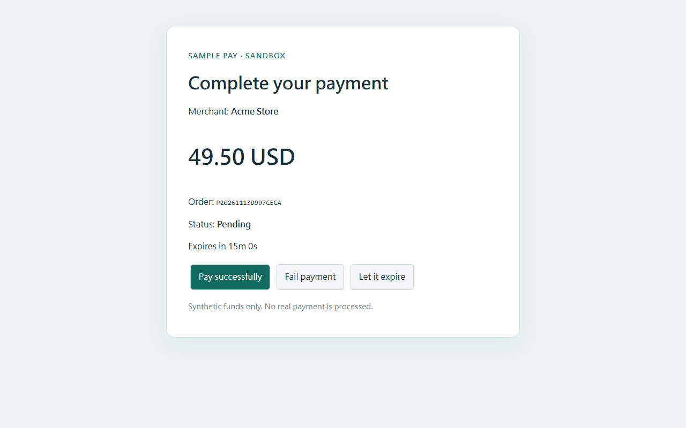
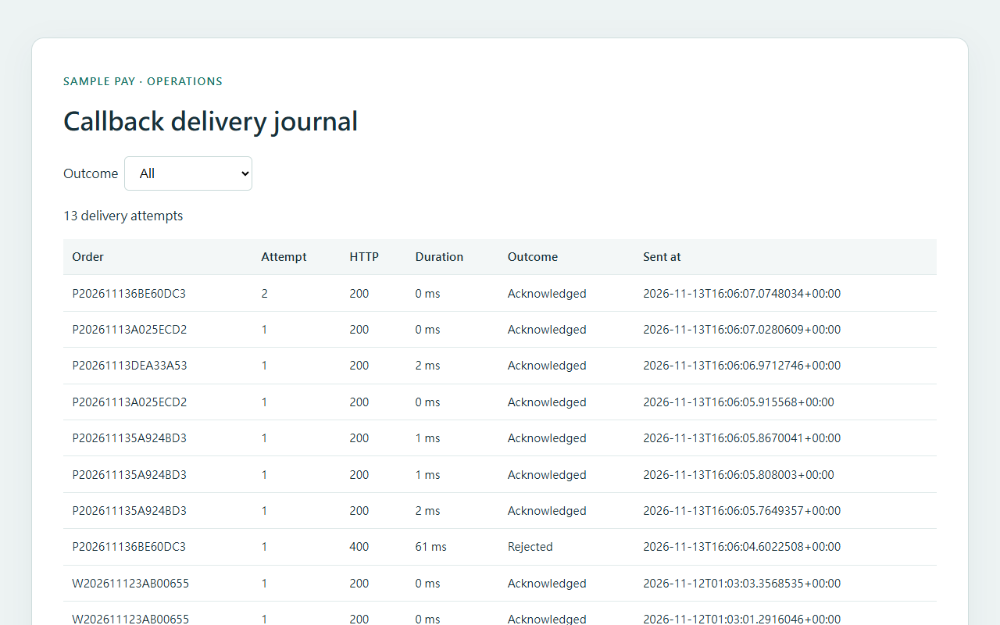
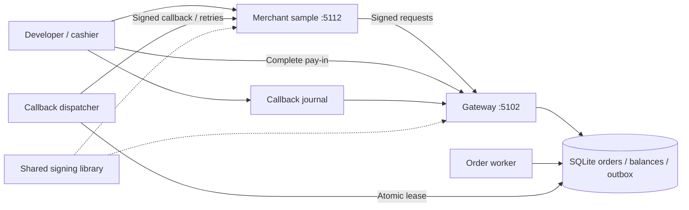

English | [繁體中文](README.zh-TW.md)

# Payment Gateway Simulator

[](https://github.com/Marc-YULIN/payment-gateway-simulator/actions/workflows/ci.yml)  

A fictional payment gateway for testing signatures, payment state machines, and unreliable callbacks without moving real money.

## Background

Distilled from patterns I built and operated in production payment / membership platforms. This repository is a clean-room implementation with synthetic data.

## Features

- Pay-in API, a local cashier, payout reservation and failure refunds, signed order queries.
- Reusable MD5, HMAC-SHA256, and RSA-SHA256 signing library; JSON and form requests.
- Durable callback outbox, atomic claims, recoverable leases, delivery history, manual resend.
- Composable delays, duplicates, reversed notifications, bad signatures, missing callbacks, and declines.
- A merchant sample that verifies responses and callbacks, deduplicates notifications, and preserves terminal states.
- Local callback journal, protected administration APIs, OpenAPI and Scalar UI.

## Screenshots



*Sandbox cashier page*



*Callback delivery journal: a bad signature rejected, then retried and acknowledged; duplicate deliveries*

## Architecture



See [architecture details](docs/architecture.md) for sequence diagrams, state machines, and the data model.

## Tech Stack

.NET 10, ASP.NET Core Minimal APIs and Razor Pages, EF Core with SQLite, built-in cryptography, xUnit, NSubstitute, and WebApplicationFactory. No external frontend assets or services are required.

## Getting Started

Use the .NET SDK pinned in `global.json`. From the repository root:

```sh
dotnet restore PaymentSim.slnx
dotnet build PaymentSim.slnx --no-restore
dotnet run --project src/PaymentSim.Api --no-restore
```

In another terminal:

```sh
dotnet run --project samples/MerchantReceiver --no-restore
```

Alternatively, with Docker and Compose installed:

```sh
docker compose up --build
```

The gateway listens on `http://localhost:5102`, the merchant on `http://localhost:5112`. Check `/health` on both before creating an order. Open the gateway's `/scalar` for API discovery and `/openapi/v1.json` for its contract. The merchant also exposes `/openapi/v1.json`.

## Configuration

Use environment variables with `__` replacing `:`. Defaults are synthetic sandbox credentials.

| Key | Default | Purpose |
| --- | --- | --- |
| `ConnectionStrings:PaymentSim` | `Data Source=appdata/payment-gateway-simulator.db` | SQLite path relative to gateway content root |
| `Simulator:AdminKey` | `dev-admin-key` | Administration header and journal query key |
| `Simulator:PublicBaseUrl` | `http://localhost:5102` | Browser-accessible cashier links |
| `Simulator:BackgroundWorkersEnabled` | `true` | Payout, expiry and callback workers; disabled in integration tests |
| `Seed:M1001Secret` | `demo-hmac-secret` | HMAC merchant secret, applied only when initially seeding |
| `Seed:KeyDirectory` | `appdata/keys` | Persisted first-start RSA key pairs |
| `Retry:BaseDelaySeconds` | `5` (`2` in Development) | First retry baseline |
| `Retry:MaxDelaySeconds` | `600` | Retry delay ceiling, including jitter |
| `Retry:MaxAttempts` | `8` | Attempts before dead-lettering |
| Merchant `Gateway:BaseUrl` | `http://localhost:5102` | Gateway URL; `http://simulator:5102` in Compose |
| Merchant `Gateway:MerchantId` | `M1001` | Demo merchant identity |
| Merchant `Gateway:Scheme` | `HMAC-SHA256` | Request and verification scheme |
| Merchant `Gateway:SharedSecret` | `demo-hmac-secret` | HMAC/MD5 credential |
| Merchant `Gateway:PrivateKeyPemPath` | null | Merchant RSA request-signing private key |
| Merchant `Gateway:GatewayPublicKeyPemPath` | null | Gateway RSA response/callback verification key |
| Merchant `PublicBaseUrl` | `http://localhost:5112` | Callback origin; `http://merchant:5112` in Compose |

Seed merchants: `M1001` uses HMAC and form callbacks; `M1002` uses MD5, secret `demo-md5-secret`, and JSON callbacks; `M1003` uses RSA and form callbacks. Each starts with `100000.00` USD and KRW. For RSA, set the merchant ID and scheme and point the two PEM options to `merchant-private.pem` and `gateway-public.pem` in the gateway key directory. The initial seed logs the merchant private-key **path**, never the key. Mount keys read-only into the merchant container if using RSA with Compose.

This sandbox permits HTTP callback destinations, including local services; run it only on a trusted development machine. Administration uses `X-Admin-Key`. The journal uses `?key=` for demonstration, so the key appears in browser history. Use synthetic keys, not production credentials. Database and private-key files are local sandbox data, stored without encryption. Cashier antiforgery keys are persisted in the seed key directory's `data-protection` subfolder, keeping them local to the sandbox rather than the operating-system user profile. Keep these files outside version control.

## API Walkthrough

The commands below use Bash quoting and `curl`; in PowerShell use `curl.exe`. The merchant signs each gateway request and checks the response, so these commands need no manual signature calculation.

### Pay-in and a failed first callback

```sh
curl -sS http://localhost:5102/health
curl -sS http://localhost:5112/health
curl -sS -X POST http://localhost:5112/checkout -H 'Content-Type: application/json' -d '{"amount":12.50,"currency":"USD","scenario":"bad-signature"}'
```

Open the returned `cashierUrl` and select **Pay successfully**. Visit `http://localhost:5102/admin/callbacks?key=dev-admin-key`: the first callback receives HTTP 400, then a retry is acknowledged with HTTP 200. Retries start around two seconds later in Development (five seconds in Compose), with jitter. Inspect local state:

```sh
curl -sS http://localhost:5112/orders
curl -sS http://localhost:5102/admin/api/callbacks -H 'X-Admin-Key: dev-admin-key'
```

### Duplicate and reversed notifications

```sh
curl -sS -X POST http://localhost:5112/checkout -H 'Content-Type: application/json' -d '{"amount":12.50,"currency":"USD","scenario":"duplicate:3"}'
curl -sS -X POST http://localhost:5112/checkout -H 'Content-Type: application/json' -d '{"amount":12.50,"currency":"USD","scenario":"out-of-order"}'
```

Complete each returned cashier. The duplicate case records one `applied` and two `duplicate` notifications. The reversed pay-in deliberately reports `Failed` before `Paid`; the merchant keeps the first terminal state and records the later state as `ignored`. This intentionally inconsistent simulation shows why reconciliation is necessary; the gateway's authoritative order can still be `Paid`.

### Payout and refund

```sh
curl -sS -X POST http://localhost:5112/payout -H 'Content-Type: application/json' -d '{"amount":10.00,"currency":"USD","bankCode":"DEMO","accountNo":"00001234","accountName":"Sample Person","scenario":"out-of-order"}'
curl -sS -X POST http://localhost:5112/payout -H 'Content-Type: application/json' -d '{"amount":10.00,"currency":"USD","bankCode":"DEMO","accountNo":"00001234","accountName":"Sample Person","scenario":"decline"}'
curl -sS http://localhost:5102/admin/api/merchants -H 'X-Admin-Key: dev-admin-key'
curl -sS http://localhost:5112/orders
```

Wait about five seconds. The first payout completes as `Succeeded`, then its synthetic `Processing` notification is ignored. The declined payout becomes `Rejected` and its reservation is refunded. A normal payout notifies `Processing` after two seconds and `Succeeded` about two seconds later.

### More scenarios and administration

| Scenario | Behavior |
| --- | --- |
| `normal` | Standard callbacks |
| `delay:3,duplicate:2` | Two copies per status, delayed three seconds |
| `bad-signature` | First attempt per outbox item corrupted; retries valid |
| `out-of-order` | Synthetic reversed status snapshots |
| `no-callback` | Poll signed `/gateway/query` to reconcile |
| `decline` | Pay-in fails at cashier completion; payout is rejected |

Delay accepts 0–86400 seconds, duplicates 1–20; repeated options and malformed values are rejected. `X-Sim-Scenario` overrides the signed body's scenario for sandbox fault injection. A manually resent callback bypasses scenario suppression and corruption and sends the current status once.

```sh
curl -sS -X POST http://localhost:5102/admin/api/merchants/M1001/balance -H 'X-Admin-Key: dev-admin-key' -H 'Content-Type: application/json' -d '{"currency":"USD","amount":100}'
curl -sS http://localhost:5102/admin/api/orders -H 'X-Admin-Key: dev-admin-key'
```

Replace `ORDER_NO` with a returned gateway order number:

```sh
curl -sS http://localhost:5102/admin/api/orders/ORDER_NO -H 'X-Admin-Key: dev-admin-key'
curl -sS -X POST http://localhost:5102/admin/api/orders/ORDER_NO/resend-callback -H 'X-Admin-Key: dev-admin-key'
```

For direct gateway calls and queries, use the request examples in `src/PaymentSim.Api/PaymentSim.Api.http`. Replace timestamp, nonce and signature before every request. Sign the exact flat field dictionary (amount such as `"12.50"`); `SignedPayload.FromObject` supplies camelCase names and invariant two-decimal amounts. Exclude `sign`, null and empty values; sort keys ordinally and join raw `key=value` fields with `&`, without URL encoding. Form encoding happens **after** signing. Avoid delimiter characters in new protocol designs; this unescaped convention is retained here to demonstrate legacy compatibility.

All gateway responses are JSON. Successful responses and errors for known merchants carry a signature. Errors are ProblemDetails with top-level `code` and `message` extensions. Unknown-merchant or malformed requests cannot carry a merchant signature. Codes: `1001` authentication (401), `1002` stale timestamp (401), `1003` replay (409), `2001` conflicting merchant order (409), `3001` insufficient balance (422), `9999` validation/not found/other errors (400/404, or the appropriate HTTP status).

## Design Decisions

1. **Outbox, atomic claims and leases.** An order transition, refund and callback insertion share one database transaction. A conditional update claims up to 20 due items per poll with a 30-second lease. A unique token fences completion by a stale worker. Leases recover after crashes. Delivery is at least once: a crash after the receiver commits but before the sender records success can cause a duplicate. Claiming reserves an attempt number, so a crash may leave a gap in the journal.
2. **Explicit acknowledgement.** Only HTTP 200 with trimmed, case-insensitive `success` acknowledges a callback. Redirects, other status codes and other text retry; HTTP success alone does not prove business processing. The HTTP timeout is ten seconds; stored response text is capped at 500 characters.
3. **Exponential backoff with jitter.** Retry delay is `base × 2^(attempt−1) × random(0.8,1.2)`, capped after jitter. This avoids synchronized retry waves. The default is eight attempts; exhausted notifications are dead-lettered and remain inspectable.
4. **Idempotency and monotonic state.** Gateway uniqueness is `(merchantId, merchantOrderNo)`; identical requests return the existing order, conflicting parameters return 409. Payout reservation uses a transaction and balance version, with up to three conflict retries. The sample protects `(orderNo,status)` and state updates under one lock. It uses in-memory `ConcurrentDictionary`: restart loses its data. Production receivers need durable transactions and a unique index, plus reconciliation for contradictory terminal notifications.
5. **Nonce and timestamp.** Signed timestamps permit ±300 seconds; a merchant-scoped nonce is cached ten minutes. This is a single-process sandbox cache, not a distributed replay store. Restart forgets cached nonces.
6. **Signing compatibility.** MD5 is included solely for older protocols and is unsuitable for new systems. HMAC-SHA256 is the default. RSA uses separate merchant and gateway key pairs, SHA-256 and PKCS#1 v1.5. Signature comparison is constant time; SHA-256 DigestInfo and full padding are checked for RSA. Credentials never appear in logs or admin projections.
7. **Exact money storage.** Core amounts are `decimal`; SQLite stores monetary columns as `long` scaled by 10⁴, allowing exact SQL ordering and arithmetic without `double` or lexical TEXT comparisons. API inputs allow at most two decimal places, require positive amounts, and cap single amounts at 1 billion. Currency conversion is intentionally absent. UTC timestamps also use integer ticks for SQLite range queries.
8. **Small operational scope.** `EnsureCreatedAsync` initializes SQLite without migrations. The order worker checks payout actions each second and pay-in expiry every 30 seconds; pay-ins expire after 15 minutes. Polls process bounded batches. This is a local fault-testing tool, not a production payment processor or authenticated merchant portal.

## Testing

```sh
dotnet build PaymentSim.slnx --no-restore
dotnet test PaymentSim.slnx --no-restore
```

Tests exercise canonical strings, all signing schemes and wrong keys, every state pair, scenario validation, jitter, callback retries/dead letters, duplicates, signature corruption, competing dispatchers, expired leases, authentication, replay, idempotent orders and payout refunds. Time is controlled by `ManualTimeProvider`; integration tests use isolated temporary SQLite files. HTTP callbacks use a custom handler; tests do not contact external services. Follow the walkthrough to inspect the two running services and browser pages; build container images separately when Docker is available.

## Project Structure

```text
src/PaymentSim.Signing/          Shared canonicalization and signature schemes
src/PaymentSim.Core/             Models, state machine, scenario and retry rules
src/PaymentSim.Infrastructure/   SQLite, authentication, workers and outbox
src/PaymentSim.Api/              Gateway/admin endpoints, Razor Pages and CSS
samples/MerchantReceiver/        Signed client and idempotent callback receiver
tests/PaymentSim.Tests/          Unit and isolated integration tests
docs/architecture.md            Component, sequence, state and ER diagrams
```

## Roadmap

- Persistent merchant sample storage and explicit reconciliation workflows.
- Distributed replay protection and additional callback fault patterns.
- Optional key rotation, data migrations and retention policies.

## License

[MIT](LICENSE).
