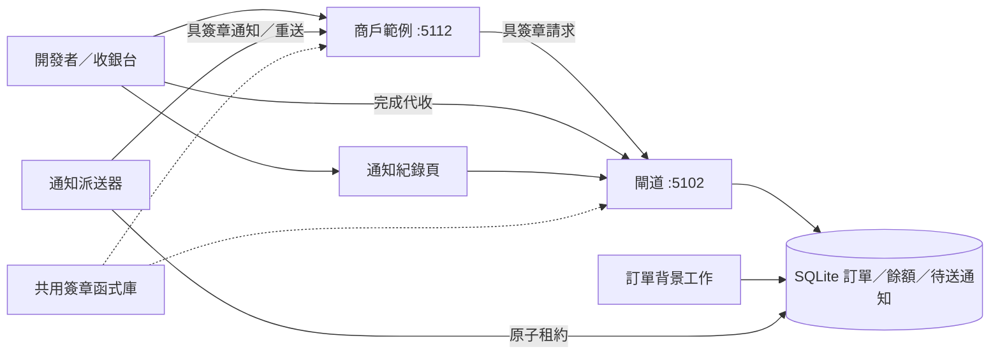

[English](README.md) | 繁體中文

# 第三方金流閘道模擬器

[](https://github.com/Marc-YULIN/payment-gateway-simulator/actions/workflows/ci.yml)  

使用虛構資料測試簽章、付款狀態機與不可靠的回呼通知，全程不移動真實款項。

## Background

本專案萃取自我在正式環境建置與維運金流／會員平台的實務模式，採獨立重新實作，並完全使用合成資料。

## Features

- 代收 API、本機收銀台、代付款項保留與失敗回補、具簽章的訂單查詢。
- 可重用的 MD5、HMAC-SHA256、RSA-SHA256 簽章函式庫，接受 JSON 與表單請求。
- 持久化待送通知、原子領取、可回收租約、派送歷史與人工重送。
- 可組合延遲、重複、亂序、錯誤簽章、不送通知與拒絕付款情境。
- 商戶範例驗證回應與通知簽章、辨識重複通知，並保護終態。
- 本機通知紀錄頁、管理金鑰保護、OpenAPI 與 Scalar 介面。

## Architecture



[架構文件](docs/architecture.md) 包含時序、狀態與資料模型圖。

## Tech Stack

.NET 10、ASP.NET Core Minimal APIs 與 Razor Pages、EF Core／SQLite、內建密碼學、xUnit、NSubstitute、整合測試工廠 (WebApplicationFactory)。不需要外部前端素材或服務。

## Getting Started

使用 SDK 鎖定檔指定的版本，從專案根目錄執行：

```sh
dotnet restore PaymentSim.slnx
dotnet build PaymentSim.slnx --no-restore
dotnet run --project src/PaymentSim.Api --no-restore
```

另開終端機：

```sh
dotnet run --project samples/MerchantReceiver --no-restore
```

也可以安裝 Docker 與 Compose 後執行：

```sh
docker compose up --build
```

閘道位於 `http://localhost:5102`，商戶位於 `http://localhost:5112`。建立訂單前先確認兩端的 `/health`。閘道的 `/scalar` 提供互動文件，`/openapi/v1.json` 提供契約；商戶也提供 `/openapi/v1.json`。

## Configuration

環境變數以 `__` 取代 `:`。預設值全部是沙箱用虛構憑證。

| 設定鍵 | 預設值 | 用途 |
| --- | --- | --- |
| `ConnectionStrings:PaymentSim` | `Data Source=appdata/payment-gateway-simulator.db` | 相對於閘道內容根目錄的資料庫位置 |
| `Simulator:AdminKey` | `dev-admin-key` | 管理標頭及紀錄頁查詢金鑰 |
| `Simulator:PublicBaseUrl` | `http://localhost:5102` | 瀏覽器可開啟的收銀台網址 |
| `Simulator:BackgroundWorkersEnabled` | `true` | 代付、到期及通知工作；整合測試關閉 |
| `Seed:M1001Secret` | `demo-hmac-secret` | 首次建立示範資料時使用的 HMAC 密鑰 |
| `Seed:KeyDirectory` | `appdata/keys` | 首次啟動產生並保存的 RSA 金鑰對 |
| `Retry:BaseDelaySeconds` | `5`，開發環境為 `2` | 第一次重送的基準秒數 |
| `Retry:MaxDelaySeconds` | `600` | 含抖動的延遲上限 |
| `Retry:MaxAttempts` | `8` | 進入停止重送狀態前的嘗試上限 |
| 商戶 `Gateway:BaseUrl` | `http://localhost:5102` | Compose 使用 `http://simulator:5102` |
| 商戶 `Gateway:MerchantId` | `M1001` | 示範商戶識別碼 |
| 商戶 `Gateway:Scheme` | `HMAC-SHA256` | 簽章與驗簽方案 |
| 商戶 `Gateway:SharedSecret` | `demo-hmac-secret` | HMAC／MD5 密鑰 |
| 商戶 `Gateway:PrivateKeyPemPath` | null | 商戶簽署請求的 RSA 私鑰檔 |
| 商戶 `Gateway:GatewayPublicKeyPemPath` | null | 驗證閘道回應／通知的 RSA 公鑰檔 |
| 商戶 `PublicBaseUrl` | `http://localhost:5112` | 通知來源網址；Compose 使用 `http://merchant:5112` |

初始商戶：`M1001` 使用 HMAC 與表單通知；`M1002` 使用 MD5、密鑰 `demo-md5-secret` 與 JSON 通知；`M1003` 使用 RSA 與表單通知。每家各有 `100000.00` USD 與 KRW。切換 RSA 時，修改商戶識別碼、方案，並將兩個 PEM 設定指向閘道金鑰目錄內的 `merchant-private.pem` 與 `gateway-public.pem`。初次建立資料時只記錄商戶私鑰的**檔案路徑**，不記錄金鑰內容。Compose 使用 RSA 時，須自行將金鑰唯讀掛載至商戶容器。

沙箱允許包含本機服務的 HTTP 通知網址，請只在可信任的開發環境執行。管理 API 使用 `X-Admin-Key`；紀錄頁為示範用途使用 `?key=`，會留在瀏覽器歷史紀錄。請使用虛構金鑰，不要使用正式憑證。資料庫與私鑰屬於未加密的本機沙箱資料。收銀台防偽金鑰保存在初始金鑰目錄的 `data-protection` 子目錄，避免依賴作業系統使用者設定檔。這些檔案不應納入版本控制。

## API Walkthrough

以下採 Bash 引號與 `curl`；PowerShell 請使用 `curl.exe`。商戶範例負責簽署閘道請求與驗證回應，無須手算簽章。

### 代收與首次通知失敗

```sh
curl -sS http://localhost:5102/health
curl -sS http://localhost:5112/health
curl -sS -X POST http://localhost:5112/checkout -H 'Content-Type: application/json' -d '{"amount":12.50,"currency":"USD","scenario":"bad-signature"}'
```

開啟回傳的收銀台網址 (cashierUrl)，按 **Pay successfully**。前往 `http://localhost:5102/admin/callbacks?key=dev-admin-key`：首次通知收到 HTTP 400，重送後收到 HTTP 200。開發環境約兩秒後開始重送，Compose 約五秒，皆有隨機抖動。檢視商戶狀態：

```sh
curl -sS http://localhost:5112/orders
curl -sS http://localhost:5102/admin/api/callbacks -H 'X-Admin-Key: dev-admin-key'
```

### 重複與亂序通知

```sh
curl -sS -X POST http://localhost:5112/checkout -H 'Content-Type: application/json' -d '{"amount":12.50,"currency":"USD","scenario":"duplicate:3"}'
curl -sS -X POST http://localhost:5112/checkout -H 'Content-Type: application/json' -d '{"amount":12.50,"currency":"USD","scenario":"out-of-order"}'
```

逐一完成收銀台付款。重複情境會記錄一次套用 (applied) 與兩次重複 (duplicate)。亂序代收刻意先送失敗 (Failed)，再送已付款 (Paid)；商戶保留第一個終態，將後到通知記為忽略 (ignored)。這是刻意不一致的模擬，用來說明對帳的重要性；閘道權威訂單仍可能是已付款 (Paid)。

### 代付與退回保留款

```sh
curl -sS -X POST http://localhost:5112/payout -H 'Content-Type: application/json' -d '{"amount":10.00,"currency":"USD","bankCode":"DEMO","accountNo":"00001234","accountName":"Sample Person","scenario":"out-of-order"}'
curl -sS -X POST http://localhost:5112/payout -H 'Content-Type: application/json' -d '{"amount":10.00,"currency":"USD","bankCode":"DEMO","accountNo":"00001234","accountName":"Sample Person","scenario":"decline"}'
curl -sS http://localhost:5102/admin/api/merchants -H 'X-Admin-Key: dev-admin-key'
curl -sS http://localhost:5112/orders
```

等候約五秒。第一筆代付先完成為成功 (Succeeded)，後送的處理中 (Processing) 通知會被忽略。拒絕的代付成為已拒絕 (Rejected)，並退回保留款。正常代付約兩秒後通知處理中 (Processing)，再過約兩秒通知成功 (Succeeded)。

### 其他情境與管理

| 情境 | 行為 |
| --- | --- |
| `normal` | 正常通知 |
| `delay:3,duplicate:2` | 每個狀態各送兩份，延遲三秒 |
| `bad-signature` | 每筆待送通知的首次嘗試簽章損壞，重送正常 |
| `out-of-order` | 合成亂序狀態快照 |
| `no-callback` | 不送通知，改用簽章查詢 `/gateway/query` 對帳 |
| `decline` | 代收於收銀台完成時失敗；代付直接拒絕 |

延遲接受 0–86400 秒，份數接受 1–20；重複選項或格式錯誤會被拒絕。`X-Sim-Scenario` 可覆蓋已簽章內文的情境，以注入沙箱異常。人工重送會略過情境抑制與簽章破壞，只送一次目前狀態。

```sh
curl -sS -X POST http://localhost:5102/admin/api/merchants/M1001/balance -H 'X-Admin-Key: dev-admin-key' -H 'Content-Type: application/json' -d '{"currency":"USD","amount":100}'
curl -sS http://localhost:5102/admin/api/orders -H 'X-Admin-Key: dev-admin-key'
```

將 `ORDER_NO` 換成實際回傳的閘道單號：

```sh
curl -sS http://localhost:5102/admin/api/orders/ORDER_NO -H 'X-Admin-Key: dev-admin-key'
curl -sS -X POST http://localhost:5102/admin/api/orders/ORDER_NO/resend-callback -H 'X-Admin-Key: dev-admin-key'
```

直接呼叫閘道或查詢時，請參考下列請求檔；每次都要換新時間戳、nonce 與簽章。

```text
src/PaymentSim.Api/PaymentSim.Api.http
```

簽署實際的扁平欄位字典，金額例如 `"12.50"`；簽章資料轉換方法 (SignedPayload.FromObject) 提供 camelCase 欄名與不受地區設定影響的兩位小數。排除簽章欄位 (sign)、null 與空字串，鍵依 ordinal 排序，以 `&` 串接未做 URL 編碼的 `key=value`；表單編碼在簽章**之後**進行。新協定應避免未跳脫的分隔字元；此處保留這種慣例來示範舊式相容性。

閘道回應皆為 JSON，成功回應與已知商戶錯誤包含簽章。錯誤採 ProblemDetails，頂層擴充包含錯誤碼 (code) 與訊息 (message)。未知商戶或無法解析的請求無法提供商戶簽章。錯誤碼：`1001` 驗證失敗（401）、`1002` 時間戳逾時（401）、`1003` 重放（409）、`2001` 商戶單號衝突（409）、`3001` 餘額不足（422）、`9999` 驗證／查無資料／其他錯誤（400／404 或相應狀態）。

## Design Decisions

1. **待送匣、原子領取與租約。** 狀態轉換、回補與通知新增共用一個資料庫交易。每輪條件更新最多領取 20 筆，租約為 30 秒，唯一租約識別碼阻止舊工作者回寫結果。當機後可回收租約；派送保證至少一次，若接收端已提交而送出端尚未記錄成功便當機，仍可能重複通知。領取時即保留嘗試編號，因此當機可能使紀錄編號出現缺口。
2. **明確確認字串。** 只有 HTTP 200 且去除前後空白後、不分大小寫等於 `success` 才視為送達。重新導向、其他狀態碼與其他文字皆重試；HTTP 成功不等於業務處理完成。HTTP 逾時十秒，回應紀錄上限 500 字元。
3. **指數退避加抖動。** 延遲為 `base × 2^(attempt−1) × random(0.8,1.2)`，加抖動後再套上限，避免同步重送。預設最多八次；耗盡後停止重送，但保留紀錄供查核。
4. **冪等與狀態單調性。** 閘道以商戶及商戶單號組合作為唯一鍵，相同參數回原單，參數衝突回 409。代付保留款使用交易與餘額版本，最多重試三次衝突。商戶範例以鎖保護單號、狀態組合的去重與狀態更新，採記憶體並行字典 (ConcurrentDictionary)，重啟會遺失資料。正式接收端必須使用持久化交易與唯一索引，並對互相矛盾的終態進行對帳。
5. **防重放。** 已簽章時間戳允許前後 300 秒，商戶各自的 nonce 快取十分鐘。這是單一程序沙箱，不是分散式防重放儲存；重啟會忘記 nonce。
6. **簽章相容性。** MD5 僅供舊協定相容，不適合新系統；預設採 HMAC-SHA256。RSA 使用獨立商戶與閘道金鑰對、SHA-256 及 PKCS#1 v1.5。簽章使用固定時間比較，RSA 驗證完整填補與 SHA-256 DigestInfo。憑證不出現在 log 或管理查詢結果。
7. **精確金額儲存。** 核心使用十進位數值，SQLite 以放大 10⁴ 倍的整數存金額，讓 SQL 排序與運算保持精確，避免浮點誤差與文字排序。API 金額限正數、最多兩位小數、單筆上限十億，不做匯率換算。UTC 時間也以整數 ticks 儲存，以利 SQLite 範圍查詢。
8. **維運範圍刻意縮小。** 資料庫初始化方法 (EnsureCreatedAsync) 建立 SQLite，不使用 migrations。訂單背景工作每秒檢查代付、每 30 秒檢查代收到期；代收期限 15 分鐘。每輪限制處理筆數。這是本機異常測試工具，不是真實收付款系統或具商戶登入的入口。

## Testing

```sh
dotnet build PaymentSim.slnx --no-restore
dotnet test PaymentSim.slnx --no-restore
```

測試涵蓋固定簽章原文、三種方案與錯誤金鑰、全部狀態組合、情境驗證、抖動、重送與停止重送、重複通知、錯誤簽章、派送器競爭、過期租約、驗證、防重放、冪等及代付回補。手動時間提供者 (ManualTimeProvider) 控制時間；整合測試使用獨立暫存 SQLite 檔案。HTTP 通知使用自訂 handler，不連外部服務。依操作流程確認兩個實際服務與瀏覽器頁面；有 Docker 時另行建置映像。

## Project Structure

```text
src/PaymentSim.Signing/          共用簽章原文與簽章方案
src/PaymentSim.Core/             模型、狀態機、情境與重送規則
src/PaymentSim.Infrastructure/   SQLite、驗證、背景工作與待送通知
src/PaymentSim.Api/              閘道／管理端點、Razor Pages 與 CSS
samples/MerchantReceiver/        具簽章的用戶端與冪等接收器
tests/PaymentSim.Tests/          單元與獨立整合測試
docs/architecture.md            元件、時序、狀態與資料模型圖
```

## Roadmap

- 商戶範例持久化儲存及明確對帳流程。
- 分散式防重放與更多通知異常模式。
- 選用金鑰輪替、資料遷移與保留政策。

## License

[MIT](LICENSE)。
