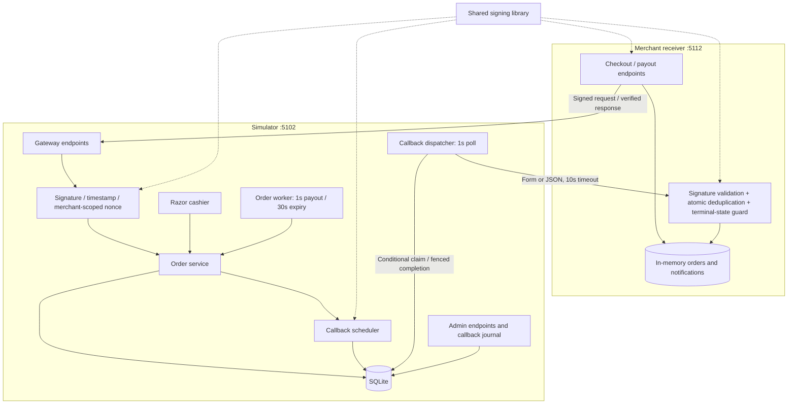
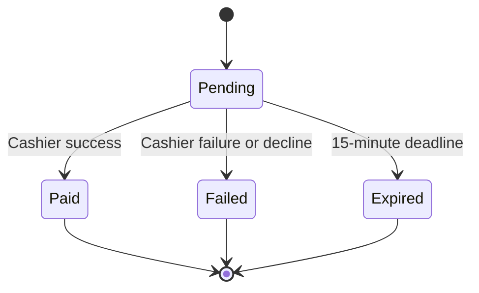
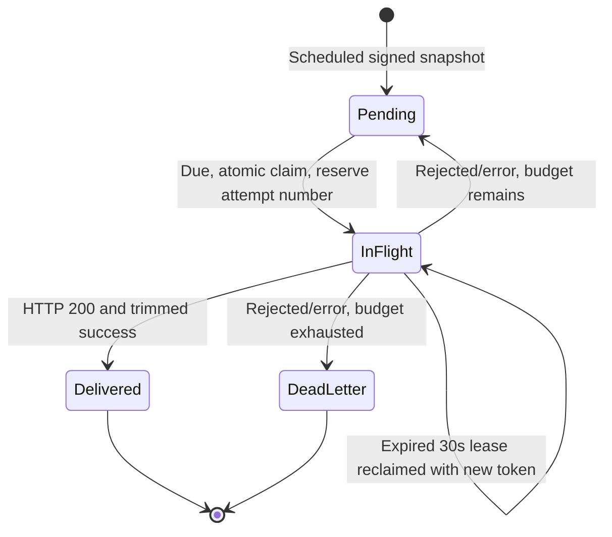
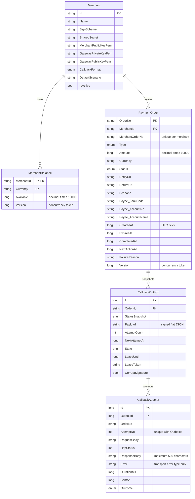

# Architecture

The simulator is a local sandbox with synthetic funds. The gateway is authoritative; the merchant sample is a deliberately small integration example. All diagrams describe implemented behavior.

## Components



Core contains models and deterministic rules. Infrastructure owns SQLite, cryptography integration, HTTP and workers. API contains endpoints, views and composition. Signing is independent and shared by the gateway and merchant sample.

## Pay-in

```mermaid
sequenceDiagram
    actor User
    participant Merchant
    participant Gateway
    participant DB as SQLite
    participant Dispatcher
    User->>Merchant: POST /checkout
    Merchant->>Merchant: Register local order, sign exact fields
    Merchant->>Gateway: POST /gateway/payin
    Gateway->>Gateway: Verify signature, timestamp, nonce
    Gateway->>DB: Transaction: lookup merchant-order uniqueness, insert Pending
    Gateway-->>Merchant: Signed order number, cashier URL, status
    Merchant->>Merchant: Verify gateway signature
    Merchant-->>User: Cashier URL
    User->>Gateway: Open cashier; POST Pay successfully (antiforgery token)
    Gateway->>DB: Transaction: state version + terminal state + signed outbox
    loop Poll due notifications
        Dispatcher->>DB: Atomic conditional claim; 30s lease and unique token
        Dispatcher->>Merchant: Signed status snapshot
        Merchant->>Merchant: Verify, deduplicate, guard state, record
        alt HTTP 200 and trimmed success
            Merchant-->>Dispatcher: success
            Dispatcher->>DB: Transaction: token-fenced Delivered + attempt
        else Invalid signature, other body/status, transport failure
            Merchant-->>Dispatcher: fail or error
            Dispatcher->>DB: Transaction: Pending with retry delay or DeadLetter + attempt
        end
    end
```

The cashier detects already-expired orders even between expiry polls. Repeated completion of an already-terminal pay-in returns the existing order without scheduling another transition. Manual resend deliberately creates a new outbox item of the current state.

## Payout

```mermaid
sequenceDiagram
    participant Merchant
    participant Gateway
    participant DB as SQLite
    participant Worker as Order worker
    participant Dispatcher
    Merchant->>Gateway: Signed POST /gateway/payout
    Gateway->>Gateway: Validate authentication and request
    Gateway->>DB: Begin transaction; lookup unique merchant-order key
    alt Existing order, same parameters
        DB-->>Gateway: Existing order; no second reservation
    else New order, adequate funds
        Gateway->>DB: Decrement available, increment balance version, insert Pending
        Gateway->>DB: Commit atomically; up to 3 write-conflict retries
    else Insufficient funds
        Gateway-->>Merchant: HTTP 422, code 3001
    end
    Gateway-->>Merchant: Signed order number and status
    Worker->>DB: After 2s: read due Pending order
    alt Decline scenario
        Worker->>DB: Transaction: Rejected + refund + outbox
    else Accepted
        Worker->>DB: Transaction: Processing + outbox + next action in 2s
        Worker->>DB: Next due action: Succeeded + outbox
    end
    Dispatcher->>DB: Claim each due snapshot atomically
    Dispatcher->>Merchant: Signed status callback
    Merchant-->>Dispatcher: success after handling
```

Failed and rejected payouts refund the original reservation in the same transaction as the state change. Normal background payouts succeed; the service-level completion operation also supports failure, tested directly. A terminal transition cannot refund twice. The `out-of-order` scenario suppresses the ordinary Processing snapshot, sends Succeeded, then schedules a synthetic Processing snapshot one second later. Actual receipt order can still change during retries: the simulator provides at-least-once delivery rather than strict ordering.

## Order state machines

### Pay-in



### Payout

```mermaid
stateDiagram-v2
    [*] --> Pending: Reserve merchant balance
    Pending --> Processing: Accepted after 2s
    Pending --> Rejected: Decline; refund
    Processing --> Succeeded: Next scheduled action
    Processing --> Failed: Service completion failure; refund
    Succeeded --> [*]
    Failed --> [*]
    Rejected --> [*]
```



State transitions validate order type, and terminal states are immutable. Synthetic out-of-order payloads intentionally do not mutate the authoritative order. For pay-ins they report Failed then Paid; a receiver that preserves its first terminal state needs reconciliation against signed queries to resolve the contradiction.

## Callback outbox



Each batch selects at most 20 candidate IDs and conditionally claims each candidate, rechecking eligibility at update time. An unexpired lease is not claimable by a second dispatcher. Completion requires the same token and commits the outbox result and attempt record together. A crash after an HTTP side effect still permits redelivery; consumers must be idempotent. A crash before recording an attempt can leave a reserved attempt number without a journal row.

Retry delay is exponential with ±20% jitter and an inclusive ceiling after jitter. Defaults: base five seconds (two in Development), max ten minutes, eight attempts. A corrupt-signature scenario modifies the wire payload on attempt one only; the stored signed snapshot remains correct. No-callback suppression can be bypassed by the explicit administration resend operation. Only the current order status is manually resent, once.

## Data model



SQLite is initialized with `EnsureCreatedAsync`; schema migrations are intentionally absent. Monetary values use decimal in Core and integer scaled storage; UTC instants use integer ticks so due-item filters execute in SQL. API amounts accept two fractional digits. Balances and orders carry optimistic concurrency versions. Callback bodies omit payee account data; admin order projections mask account numbers and omit private credentials.

## Trust and operating boundaries

- Gateway requests sign exact scalar fields, then enforce a ±300-second timestamp and a ten-minute merchant-scoped nonce cache. The cache is single-process and clears on restart.
- The merchant verifies gateway responses and callbacks, checks known local order identity, amount, currency and type, and applies deduplication plus state update under one lock before returning success. Its storage is volatile; production needs a transactional database and unique index.
- Admin APIs require `X-Admin-Key`; the demonstration journal uses a query key and disables caching and referrers. Use only synthetic keys on a trusted development machine.
- Callbacks intentionally reach local HTTP services. This sandbox is not an internet-facing relay. No real provider, real bank or real funds are involved.
- PEM files and credentials in SQLite are unencrypted local development artifacts. Protect and retain them together; first-start keys must remain consistent with seeded merchant records. Docker persists gateway appdata in a named volume.
